# Eclipse Crew — Architecture

Eclipse Crew is an open-source, self-hosted platform for AI teammates. A crew of named agents shares one Linux desktop (real browser, terminal and files), each isolated under its own Linux user, and streamed live into a local web workspace where the owner can watch or take over at any time.

> **Status:** target architecture (design stage). Items are tagged **[M]** must-have for v1, **[S]** should-have, **[L]** later. Anything not tagged is part of the core design.

---

## Contents

1. [Design principles](#1-design-principles)
2. [System context](#2-system-context)
3. [Deployment topology](#3-deployment-topology)
4. [Services](#4-services)
5. [Technology stack](#5-technology-stack)
6. [Agent runtime](#6-agent-runtime)
7. [Perception layer](#7-perception-layer)
8. [Model provider layer](#8-model-provider-layer)
9. [Proof receipts](#9-proof-receipts)
10. [Checkpoints, rewind and branching](#10-checkpoints-rewind-and-branching)
11. [Skills and teach mode](#11-skills-and-teach-mode)
12. [Routines, jobs and scheduling](#12-routines-jobs-and-scheduling)
13. [Memory](#13-memory)
14. [Multi-agent work](#14-multi-agent-work)
15. [Security architecture](#15-security-architecture)
16. [Authentication](#16-authentication)
17. [Data and storage](#17-data-and-storage)
18. [Cost control](#18-cost-control)
19. [Date and time](#19-date-and-time)
20. [Voice](#20-voice)
21. [Web workspace](#21-web-workspace)
22. [CLI](#22-cli)
23. [Key flows](#23-key-flows)
24. [Non-functional requirements](#24-non-functional-requirements)
25. [Open questions](#25-open-questions)
26. [Glossary](#26-glossary)

---

## 1. Design principles

| Principle | Architectural consequence |
|---|---|
| **Proof over claims** | Every step is verified and leaves a signed, hash-chained receipt. |
| **Need-to-know** | Default-deny role policies; isolation enforced by the OS, not the prompt. |
| **Only the user gives orders** | All content carries a source tag; untrusted content is data, never instructions. |
| **Don't call the AI when code will do** | Deterministic replay, cheap probes before model calls, code-resolved dates. |
| **The user's machine, the user's data** | Everything stored locally; only model and tool calls leave, through one egress proxy. No telemetry. |
| **Honest limits** | CAPTCHAs, OTPs, payment verification and anti-automation sites are handed to the human. |
| **Model-agnostic** | A perception layer gives every model the same behaviour and safety; only precision varies. |

---

## 2. System context

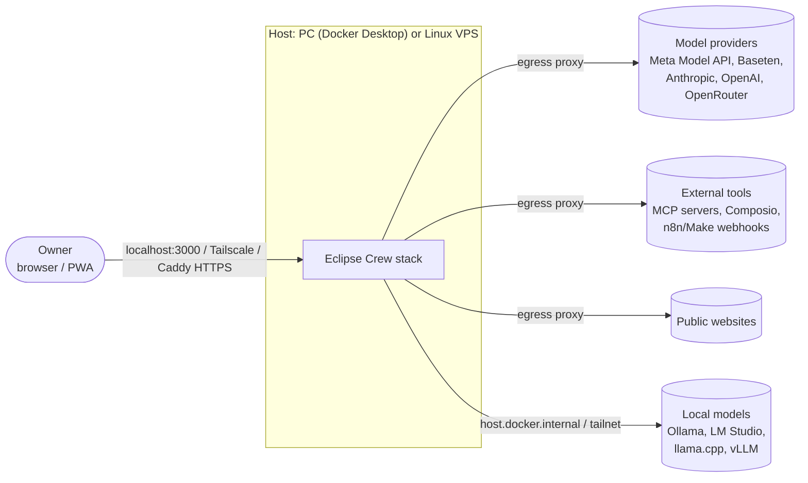

- One install equals one owner. The owner reaches the web app locally on `127.0.0.1:3000`, or remotely through Tailscale (recommended) or Caddy with automatic HTTPS.
- All outbound traffic from agents and tools goes through the **egress proxy**.

---

## 3. Deployment topology

The target is one `docker compose up` on Windows (Docker Desktop / WSL 2), macOS and a Linux VPS. All services use `restart: unless-stopped`. ADR-024 adds a fixed-purpose localhost ingress to the four core services.

**Current build:** five services start after supplying database and controller credentials. `app` serves owner setup/login and an authenticated temporary desktop shell; `desktop` provides isolated persistent graphical sessions, authenticated controller operations and view-only RFB streaming; `egress-proxy` is inert. Separate internal database, desktop and ingress-to-app networks isolate the app, database and desktop; the ingress alone also has a frontend network for localhost publication. It accepts only the fixed app upstream. Disposable Docker Desktop tests verify the current auth/desktop stack on this machine; the full agent runtime and other platforms remain unverified.

Database provisioning is explicit and rejects unexpected existing roles, schemas, objects and migration history before changes. `eclipse_app` has only SELECT, INSERT and UPDATE on the current owner table; it cannot create schemas or temporary tables, escalate roles or access migration metadata. `eclipse_migrator` owns the project schema objects and has the database CREATE permission Drizzle requires. Future migrations must grant table privileges explicitly; no blanket mutation grants exist. The app receives only its runtime URL, while a short-lived helper runs migrations on the private database network with only its migration URL. Owner-scoped queries are a separate, unfinished data-access-layer responsibility.

```
┌──────────────────────────── Host (PC or VPS) ─────────────────────────────┐
│                                                                           │
│  ingress (localhost-only fixed reverse proxy → app)                       │
│                                                                           │
│  app (Next.js UI + API + agent runtime + pg-boss job workers)             │
│    ├─ talks to: postgres, desktop-controller, egress-proxy                │
│    └─ calls: Meta Model API / Baseten / user's providers (via proxy)      │
│                                                                           │
│  postgres (Docker-managed volume)                                         │
│    └─ pg-boss tables (job queue, schedules, archive)                      │
│                                                                           │
│  desktop (Linux sandbox, internal network only)                           │
│    ├─ Linux user per agent → Xvfb screen :N → Chromium profile            │
│    ├─ desktop-controller (internal API): screenshots, xdotool input,      │
│    │    Playwright/CDP, ffmpeg recording, file checkpoints                │
│    └─ x11vnc + noVNC per screen → streamed to the web app                 │
│                                                                           │
│  egress-proxy (all outbound traffic from desktop + tools)                 │
│    ├─ per-agent domain allowlist, threat feeds, ad/tracker blocking       │
│    ├─ credential injection (tokens never reach the model)                 │
│    └─ canary tripwire scanning                                            │
│                                                                           │
│  volumes: workspace, artifacts, postgres  ·  ./data/memory (mirror)       │
└───────────────────────────────────────────────────────────────────────────┘
```

### 3.1 Network exposure

| Endpoint | Exposure |
|---|---|
| Web app (UI + API) | `127.0.0.1:3000` by default; port 443 via Caddy, or nothing with Tailscale |
| Postgres | Internal only |
| CDP (Chrome DevTools Protocol) | Inside the desktop container only |
| VNC / websockify | Internal; streamed through the app |
| desktop-controller API | Internal only |
| Jobs API / pg-boss | Internal only (no separate dashboard service) |
| Webhook triggers | `POST /api/hooks/<id>` on the app, secret token required **[S]** |

### 3.2 Optional compose profiles

| Profile | Adds | Notes |
|---|---|---|
| `local-ai` | Ollama container | Linux PC or GPU VPS **[S]** |
| `local-vision` | Local SAM 3.1 server | NVIDIA GPU, CUDA 12.6+; weights downloaded by the user, never shipped **[S]** |

---

## 4. Services

### 4.1 `app`

A single Next.js deployment plus TypeScript worker processes. `scripts/app-server.mjs` owns the Node HTTP listener and the protected desktop WebSocket upgrade. It forwards normal HTTP requests into Next.js; it does not run a separate backend service. `APP_ORIGIN` is the exact public scheme, host and port (default `http://127.0.0.1:3000`).

| Module | Responsibility |
|---|---|
| Web UI | Three-pane workspace, live desktop, Jobs dashboard, Security Center, Settings |
| API (route handlers) | REST endpoints, SSE streams, webhook triggers; Zod validation on every boundary |
| Agent runtime | Step loop, policy engine, perception layer, receipt writer, checkpoints |
| Provider layer | Model adapters (native Meta, OpenAI-compatible, Anthropic-compatible), routing, capability profiles |
| Job workers | pg-boss consumers: `routine.run`, Sundance/Moondance checks, consolidation, backup |
| Scheduler | One-minute tick over the `routines` table |
| Memory service | Single-writer queue, versioning, injection scanning, Markdown mirror |
| Auth | Owner login, sessions, CSRF, rate limiting, TOTP **[S]** |

### 4.2 `postgres`

Source of truth for all structured state: agents, policies, chats, memory, skills, routines, runs, steps, receipts metadata, approvals, security events, encrypted keys. It also holds the pg-boss queue tables. Full-text search covers past conversations **[S]**.

### 4.3 `desktop`

An Ubuntu sandbox on the internal network only. TASK-010 builds from the approved exact-package/SHA256 lock (379 archives / 218769418 bytes), installs packages offline with networking disabled, and verifies pinned Node/Chromium archives plus image-local Playwright integrity. All required tool versions execute. ADR-026 now runs a trusted root bootstrap with six explicit capabilities for Downloads and account-view mounts, then permanently drops SYS_ADMIN and installs an inherited privileged-syscall filter before starting the supervisor. Its five retained capabilities support local provisioning and UID switching; agent processes have distinct UID/GID and zero capability sets. No-new-privileges, read-only root, bounded tmpfs, isolated networks and unpublished ports remain enforced. Run c66f0dda-e890-428b-8f58-a1df20c978fa verifies authenticated Xvfb/Openbox, VNC/WebSocket transport, PNG/video, and genuine Playwright/xdotool input in graphical Chromium. Chromium’s own status page confirms namespace/PID/network and Seccomp-BPF sandboxes active. ADR-025 applies a pinned Playwright-derived seccomp profile only to desktop, with the required namespace-local chroot adaptation; the kernel still denies ordinary outer-process chroot. TASK-010 is complete. The earlier snapshot-service outage is resolved by the owner-approved package lock.

The target toolchain contains Xvfb, a lightweight window manager, Chromium (Google Chrome optional, downloaded on the user's machine at build time), `playwright-core`, xdotool, ffmpeg, x11vnc and noVNC/websockify. It also has a text editor, PDF viewer and image viewer; LibreOffice is an optional layer **[S]**.

| Per agent | |
|---|---|
| Linux user | Unique, no sudo, home mode `700` |
| Screen | Xvfb display `:(uid - 20000 + 100)`, authenticated and TCP-disabled |
| Browser | Persistent Chromium profile at `/workspace/homes/<agent-uuid>/.config/chromium`; graphical session under its own UID |
| Stream | Private view-only x11vnc → authenticated controller RFB bridge → authenticated app WebSocket → noVNC canvas |

**Current TASK-011 administration:** `npm run desktop:agent -- <create|inspect|exec> --owner UUID --agent UUID [--project NAME] [-- COMMAND ARGS]` verifies the Compose desktop and named volume before invoking fixed local commands. A root-only infrastructure registry at `/workspace/.system/agents.json` assigns stable UIDs/GIDs 20000–59999, without replacing future Postgres product records. An exclusive lock serializes creation; pending assignments keep their UID during safe recovery, while conflicting state/stale locks fail closed. Runtime passwd/group files under root-only `/run/eclipse` are mounted read-only over `/etc/passwd` and `/etc/group`; new accounts append only through trusted administration. No password/sudo is enabled. Reduced Python PID 1 reaps children; no privileged init retains SYS_ADMIN.

**TASK-012 session lifecycle:** the reduced supervisor owns a local root-only Unix socket `/run/eclipse/sessions.sock` (parent mode 700, socket mode 600). Closed `session-start`, `session-status` and `session-stop` owner commands resolve existing identities, serialize per agent and launch a capability-free worker through `setpriv`. Each worker owns authenticated Xvfb, Openbox and a graphical Playwright persistent context. CDP uses inherited anonymous pipes; no debugging port or WebSocket endpoint is opened. Display cookies and browser handles never leave private worker memory/runtime files. Chromium and Playwright do not keep cookies without an expiry across a browser restart (microsoft/playwright#36139), so the worker snapshots them to `~/.config/chromium/eclipse-session-cookies.json` (`docker/desktop/cookie-snapshot.mjs`) on close and every 30 s when they change, and restores them with `addCookies` right after launch; a bad snapshot is ignored and never blocks start.

Readiness requires the display, window manager, browser and authenticated VNC readiness. Component failure stops its session; other agents continue. Shutdown first closes the browser to flush profile state, then stops only tracked session processes; fallback uses the same UID and verified process birth identities, without CAP_KILL. Ambiguous profile/display locks are refused; proven-stale owned artifacts can be removed without following links. Container recreation retains profiles, while runtime directories and the socket are temporary; explicit start reopens an agent after recreation. Synthetic local tests cover these layers, not real credential workflows.

**Current desktop-controller (TASK-013–015):** HTTP and WebSocket require the service secret and the exact current `app` DNS peer address. DNS failure denies access. Owner IDs come from validated app sessions and are checked against the protected agent registry. Closed operation schemas cover full 1024×768 X-display screenshots/crops, xdotool click/type/key/scroll, and bounded Playwright page/locator operations. DOM results carry `source_tag: tool` and `untrusted: true`; actual password/OTP targets refuse text/fill operations. The worker has no arbitrary shell/evaluate/URL endpoint.

Lifecycle, control transitions and primitive dispatch share a bounded per-agent queue. Every dispatch rechecks owner, running state, UUID generation and takeover. A lease binds the owner session reference, viewer connection ID and generation. Disconnect releases only that viewer's lease; stop/restart closes viewers and invalidates old work. Timed-out/uncertain worker execution quarantines the session for explicit restart; it is never replayed automatically.

**Product agent lifecycle (TASK-019):** owner-scoped CRUD stores agents and default-deny policies in Postgres. Creation saves a paused row, provisions/starts the controller identity and then marks the agent active; desktop failure leaves a visible paused agent for retry. Pause stops the desktop but preserves its profile and files. Selecting an agent only reads controller status; starting a stopped desktop is an authenticated POST. Pause/resume/delete hold an owner-scoped row lock across the desktop call and required final database write so interleaving cannot orphan an identity; lock waits are capped at five seconds and the runtime pool has bounded size/connect timeout. A desktop action that succeeds before a failed final DB write leaves a retryable transient mismatch; it never reports success. Deletion first writes a root-only `deleting` registry tombstone so restart recovery skips a partially removed identity, then removes the exact UUID home/downloads, NSS account entries and registry record before deleting the owner-scoped database rows; process-scan uncertainty fails closed and registry writes use unique atomic temporary files. All desktop page/stream/takeover/input/handback routes require the owner-scoped database agent as well as the controller identity; registry-only identities are never adopted.

The app authenticates each upgrade through a fixed loopback session-validated route and revalidates within five seconds. The controller authenticates upstream VNC privately; noVNC receives RFB pixels with a separate None-security negotiation only after owner authentication. The view-only protocol accepts bounded format/encoding/framebuffer requests and rejects keyboard, pointer and clipboard events. Owner input uses separate session/Origin/CSRF-checked HTTP routes. Per-session VNC passwords never enter browser responses or public session status.

Teach recording, checkpoints/restores, opaque credential entry and the model grounding/receipt loop remain later tasks.

The desktop container mounts **only** the `workspace` volume. It never sees the database, `.env` or secrets.

### 4.4 `egress-proxy`

The single outbound path for the desktop and tools.

- per-agent default-deny domain allowlists
- blocking of internal and cloud-metadata addresses (`169.254.169.254`, RFC 1918 ranges)
- credential injection: API keys and tokens are added at the proxy and never placed in model context
- canary tripwire: kills the session when an agent's canary secret appears in outbound traffic
- threat feeds (URLhaus, OpenPhish/PhishTank, Hagezi) and look-alike domain detection **[S]**
- ad and tracker blocking **[S]**
- payment-provider redirect rules **[S]**

---

## 5. Technology stack

| Layer | Choice |
|---|---|
| Frontend | Next.js (App Router), React, TypeScript, Tailwind CSS, shadcn/ui, Lucide; PWA manifest + service worker |
| Backend | Next.js route handlers + TypeScript workers; Zod |
| Database | PostgreSQL + Drizzle ORM; Postgres full-text search |
| Jobs | pg-boss (MIT) inside Postgres; `cron-parser` with IANA timezones |
| Sandbox | Ubuntu, Xvfb, Chromium, `playwright-core` (library, not MCP), xdotool, ffmpeg, x11vnc, noVNC |
| Integrations | MCP servers (stdio/HTTP); Composio SDK (optional, user's key) **[S]** |
| Models | Native Meta adapter + OpenAI-compatible adapter + Anthropic-compatible adapter [S]; local endpoints through the OpenAI-compatible one |
| Auth | argon2id, HttpOnly SameSite session cookies, CSRF, TOTP (RFC 6238) **[S]** |
| Signing | Ed25519 key generated at install |
| Voice | Meta Voice Transcribe, any OpenAI-compatible STT, or `whisper.cpp` (MIT) locally **[S]** |
| License | Apache-2.0 (recommended, pending confirmation) |

**Why pg-boss, not Inngest:** pg-boss runs inside the existing Postgres with no extra container and is MIT-licensed. Inngest's self-hosted single-node mode is beta and SSPL-licensed. Run durability comes from Eclipse Crew's own per-step checkpoints, not the job engine.

---

## 6. Agent runtime

### 6.1 Step loop

Every step of every run follows the same loop:

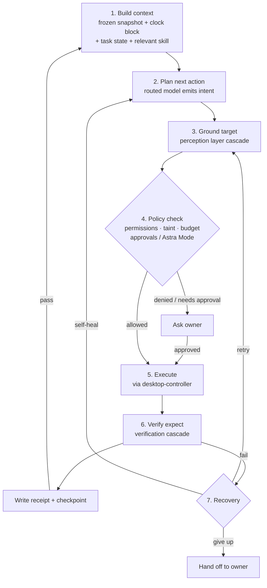

### 6.2 Run guards [M]

| Guard | Behaviour |
|---|---|
| Max steps / max tokens / wall-clock limit | Stop the run and report |
| Loop detection | The same action repeated 3× stops the run |
| Budgets | Warn at 80%, pause and ask at 100% (see §18) |
| Concurrency | One run per agent at a time (one screen); agents run in parallel |

Per-step checkpoints are also needed because stateless computer-use replay is reportedly capped at 29 screenshot/action pairs per request (to verify).

### 6.3 Takeover and hand-off

- The owner can take over any screen (mouse + keyboard). The agent pauses and resumes on **Hand back**.
- Current transport leases stop agent input and screenshot dispatch after takeover acknowledgment. Route leave/disconnect releases the bound lease; the later agent runtime must use the same guarded primitives.
- Agents pause at login walls, CAPTCHAs, OTPs and payment verification and hand off to the owner.
- Nothing is screenshotted or recorded during takeover, except when the owner explicitly presses **Record** in teach mode. Logins, CAPTCHAs and OTP entry are never recorded.

### 6.4 Structured replies [M]

Agent chat output is validated with Zod into one of four card types:

| Card | Purpose |
|---|---|
| `message` | Plain reply |
| `clarification` | Asks for missing parameters |
| `tool_connection` | Inline card to connect a tool |
| `routine` | Schedule blueprint for confirmation |

TASK-022 implements the durable chat boundary: users append validated text messages through the owner-scoped API, while agent, tool and background output enters only through the server-only append function. The workspace renders all four cards, reloads bounded history and polls visible timelines so appended run results appear without adding the later SSE channel. Card actions that connect credentials or save routines remain display-only until TASK-046/038. Files written to `outbox/` appear as **file result cards** (preview, Download, Show in Files, Open on the agent's desktop).

---

## 7. Perception layer

The perception layer sits between every brain model and the screen. Muse, Claude, GPT, Glimmer or any other model gets the same behaviour, receipts and safety rules; only precision differs.

### 7.1 Intent schema [M]

Models never emit raw coordinates. They emit:

```json
{ "action": "click", "target": "Submit button", "expect": "order confirmation appears" }
```

### 7.2 Grounding cascade [M]

The layer uses the best available method first and cross-checks when two methods agree:

1. **Page structure:** Playwright/CDP element refs and accessibility snapshots (any tool-calling model).
2. **Set-of-marks [S]:** numbered boxes drawn on the screenshot from page structure, the Linux accessibility tree or local OCR (any vision model).
3. **SAM 3.1 pixel masks:** only if enabled.
4. **The model's own computer-use coordinates:** only if the model supports computer use.
5. **Hand off to the owner.**

### 7.3 Verification cascade [M]

Each `expect` is checked with, in order:

1. page-structure postconditions
2. pixel diff of the target region **[S]**
3. local OCR **[S]**
4. SAM 3.1 before/after masks (if enabled)
5. model judgement (last resort)

The receipt records which methods ran and a confidence score.

### 7.4 Confidence gate [M]

Irreversible actions (purchase, send, delete, payment hand-off) need **high confidence, meaning two methods agree**. Otherwise the agent asks. Weaker setups ask more often; they don't misclick.

### 7.5 Capability profile [M]

When a provider is added, the layer detects tool calling, vision, video, audio (with known caveats, e.g. Muse Spark 1.3 audio degraded), computer use and context size. Methods are then chosen automatically, with no user configuration. Tool calling is the minimum for an agent.

TASK-021 implements hybrid capability profiles in `lib/providers/capabilities.ts`: live forced-tool and exact vision-confirmation probes, provider model metadata, and documented Meta media/computer/context profiles. Failed or incomplete probes stay `unknown`; only a validated no-tool completion is `unsupported`. `assertAgentCapable()` rejects models that cannot satisfy the tool-calling minimum.

### 7.6 Media adapter [S]

The media adapter converts inputs to what the active model accepts:

| Model accepts | Receives |
|---|---|
| Video + audio | Video + audio |
| Video, no reliable audio | Video + transcript |
| Images only | Teach-capture step list + before/after screenshots + transcript |
| Text only | Transcript + page snapshots |

Transcripts come from Voice Transcribe, or local `whisper.cpp` offline.

### 7.7 SAM 3.1 options

SAM 3.1 is optional, an enhancer and never a requirement.

| Option | Needs | Cost | Priority |
|---|---|---|---|
| Meta API (`sam-3.1`) | Meta key | $2.50 / 1k images | [M] |
| Local (`local-vision` profile) | NVIDIA GPU, CUDA 12.6+, Python 3.12+, PyTorch 2.7+; gated Hugging Face weights (3.50 GB FP32) | Free, offline | [S] |
| Off | — | Free | Default with no Meta key or GPU |

Only single images are used for verification. CPU-only SAM is not offered for per-step use (too slow).

TASK-008 adds a server-only developer CLI, `spike:sam-screenshot`, separate from the future perception adapter. With explicit `--live` consent it makes one non-streaming `sam-3.1` request to the fixed Meta Responses endpoint using the existing private host key, the fixed concept `button` and a validated owner-selected PNG. It uses `store:false`, compact one-bit masks and confidence metadata. It has a 30-second request/read deadline, an 8 MiB response cap and no retries; billing is for one image, not Muse reasoning tokens. Specialized SAM input contains only the concept and image, with UTC evidence time generated by code. No computer tool, replay state or input execution is involved. The direct endpoint exception is development-only; product SAM remains off by default.

Before the official pinned parser can allocate masks, complete wire preflight enforces frame 0, paired box/mask records, unique IDs, exact source dimensions, inclusive in-bounds geometry, confidence, at most 64 objects and 16 million decoded pixels total. Masks must be nonempty and decode canonically; source-aligned monochrome PNGs and sanitized metadata are written exclusively under ignored `data/spikes/task-008/<uuid>/`. Zero matches is a normal incomplete-target outcome. Raw responses, encoded payloads, provider IDs, credentials and source-image copies are excluded. Precise safe stage/reason/schema/parser codes distinguish failures without logging arbitrary provider text. Live run b91a98d6-8c75-408b-9b01-bfbba38c92b0 validated one mask in 2122 ms; agent visual comparison confirmed View project status. This completes the developer spike, not production grounding/verification. Original request-time evidence remains unchanged.

### 7.8 Model check [S]

The owner-approved spike:meta-live-click developer test uses fresh credential-free Firefox on the verified local placeholder only. It keeps model coordinates as internal grounding data for a fixed click intent, independently validates the point/scene, executes at most once and verifies details closed→open plus visible status. Screenshots explicitly use original detail in all newly constructed image items. Validated PNG dimensions must equal viewport CSS dimensions at DPR1; viewport capture uses no crop or full-page expansion. The request states actual image dimensions and pixel coordinates without target hints. Geometry mismatches fail closed. Limits: low reasoning, 1024 output tokens/request, 3072 total, at most three requests, 30 seconds/request and 90 seconds active model time; no retries. Generic computer_action_requires_confirmation may pause for specific owner approval only after target validation; a run/action-scoped single-use stdin token binds that reply. Review is capped at five minutes, excluded from model time, and never auto-approved. Raw checks/call IDs/receipts stay in memory. After approval and rechecking, execute once and replay genuine history with exact reviewed checks and real after-image for acknowledgement. Unknown genuine metadata and documented assistant phases are preserved; action schemas remain strict. Further returned actions never execute. Execution/postcondition/acknowledgement states remain separate. Private local-page before/after and safe metadata live under ignored data/spikes/task-007-live-click/. This does not implement production desktop/egress services. Earlier calls/unknown discarded fields remain historical. Earlier reviewed-flow run d1395501-fc64-4938-bb4e-676bd3e3fef0 successfully completed observation/replay, then failed the independent target gate at (359,483), below the button. No review was requested and no input/acknowledgement occurred. Two calls used 191/176 output tokens; larger caps did not resolve grounding. TASK-007 remains open; production page-structure/SAM grounding is still future work. Original-detail run 3e06d19f-8460-4162-968a-7ea98b134318 verified 1280x800/DPR1 and the unchanged screenshot hash, but returned (359,483), below the button ending y=466. One Contributor request used 3559 input / 670 output tokens (584 reasoning); wrong_target stopped before review/input/acknowledgement. Original detail did not resolve the miss; no token cap was reached.

When a model is added, it runs about 10 standard tasks on the built-in mock vendor portal. The result is shown as a score and expected behaviour, e.g. "8/10, purchases will ask for approval".

---

## 8. Model provider layer

### 8.1 Adapters

- **OpenAI-compatible adapter:** OpenAI, OpenRouter, Baseten, other compatible providers, and local servers (Ollama, LM Studio, llama.cpp, vLLM). Base URL + key.
- **Anthropic-compatible adapter [S]:** Anthropic's Messages API and any endpoint that speaks the same format. Base URL + key. Handles tool calling, image input, prompt-cache markers, and Claude's computer-use tool (translated through the intent schema, §7.1). See ADR-023.
- **Native Meta adapter:** Muse models, including the Responses API computer tool (`tools: [{type: "computer"}]`) on `muse-wonder-1.0` / `muse-spark-1.3`, batched actions in screenshot pixel coordinates, and acknowledgement of `pending_safety_checks`.

TASK-021 implements the server-only provider modules in `lib/providers/`. Adapters are keyless and receive an injected `ProviderTransport`; they never accept API keys or add authentication headers. A separately approved minimal TASK-046 egress-proxy authenticated transport is required before any live Settings call, with no direct-auth or proxy-bypass exception. Requests and provider output are bounded and schema-validated; source-tagged text is JSON-framed so untrusted text cannot forge a new tag. Meta computer continuation requires the exact validated `call_id`, actions, replay items and explicitly approved safety checks, never an automatic acknowledgement. Usage is required before a result is accepted so cost accounting cannot silently disappear. TASK-021 proves these boundaries with mocked transports only; live provider connectivity remains pending.

TASK-007 provides a standalone, server-only developer probe with a bounded read-only observation loop. The owner-selected muse-spark-1.3-contributor model receives a text-only observation request, then the validated static PNG as computer_call_output only after a single valid screenshot call with empty safety checks. At most two requests use minimal reasoning, 512 output tokens each (1024 total), a 30-second per-request deadline and 45-second total deadline. No retries or desktop input occur. A click before the image is supplied is rejected. Native coordinates remain provider-grounding evidence, separate from product intents; no provider adapter, desktop driver, egress proxy or production receipts are implemented. A genuine validated live click and owner target confirmation are required for completion.

Safety metadata is schema-validated before classification. Opaque check strings follow Meta's string types and are bounded by the 1 MiB response cap rather than an invented 128-character ID limit. Malformed metadata produces `invalid_response`; valid nonempty checks produce `safety_review_required`. The general result contains only safe codes/counts and field/type/constraint diagnostics. A separate private `safety-review.json` preserves bounded sanitized explanations for review, never opaque IDs or raw payloads. It is explicitly untrusted tool data and never triggers execution or automatic acknowledgement. Historical discarded check reasons cannot be reconstructed from old evidence.

Stateless store:false continuation retains the genuine computer_call, call_id and meta_safety_replay_receipt unchanged, with documented reasoning items carried only in memory. Missing/malformed replay data stops before a second request. The supplied PNG is a static test scene, never represented as a fresh host capture. Per-turn stages, request counts and numeric usage are saved; opaque handles, receipts, reasoning and raw payloads are excluded. Repeated screenshot requests, unsafe/malformed output and exhausted budgets stop without accepting a click. Earlier one-shot evidence remains unchanged. Latest live evidence f4aa6650-f817-4148-8802-bb369129efcc contains a valid empty-check screenshot request, but continuation failed replay validation before a second call. Its finer replay reason was not retained and cannot be reconstructed. New executions expose only whitelisted replay subreason codes; the provider remains responsible for receipt authenticity verification. TASK-007 is still open.

### 8.2 Roles

Each job has its own provider, model and key:

| Role | Options | Required |
|---|---|---|
| **Main AI** | Meta, Anthropic, OpenAI, OpenRouter, Baseten, Custom/Local | Yes |
| **Vision precision (SAM 3.1)** | Off · Meta API · Local GPU | No |
| **Voice (STT)** [S] | Meta Voice Transcribe · OpenAI-compatible `/v1/audio/transcriptions` · audio-capable chat model · local Whisper · Off | No |
| **Images** [S] | Muse Image · Off (initials) | No |
| **Background jobs** [S] | Same as Main AI · any provider (e.g. local Glimmer) | No |

- **"Use the same key as Main AI"** appears on every other role when it uses the same provider, and is ticked by default.
- **Saved keys** are encrypted at rest, masked (`••••1a2b`), never shown again and never sent to the model. The egress proxy injects them.
- Each role has a **Test** button that makes a minimal call and reports the model list, latency and GPU detection.
- **Local auto-detection [S]** probes `host.docker.internal:11434` (Ollama), `ollama:11434` (compose profile), `host.docker.internal:1234` (LM Studio) and the NVIDIA GPU.
- **Per-agent overrides [S]** let one agent use a different setup, e.g. "local only": the agent never sends content to a cloud model.

TASK-020 implements Settings → Models for Main AI and SAM 3.1. Owner-scoped `providers` rows hold encrypted keys and last-four hints; `model_roles` holds one row per owner/role, with SAM either off, sharing the Main provider through `use_main_key`, or using its own Meta key. Main supports Meta and OpenAI-compatible endpoints, while SAM supports Off or Meta API. The server never returns plaintext or ciphertext, accepts blank key input as "keep the saved key", and refuses to change Main away from Meta while SAM depends on that key.

Test uses only saved configuration, returns a bounded model list and measured latency through the keyless connector with an injected transport, and has its own owner-wide rate limit. The production route currently fails closed with `authenticated_transport_unavailable`: real Settings Test calls remain pending TASK-046's proxy-backed credential injection, and TASK-020 adds no direct-auth fallback or outbound provider call.

### 8.3 Routing [M]

| Work | Default model |
|---|---|
| Chat, planning, routine compilation, extraction | Muse Spark |
| Hard computer-use steps, recovery after Spark fails | Muse Wonder (preview; falls back to Spark) |
| Grounding and verification | SAM 3.1 (if enabled) |
| Probes, quarantined reader, consolidation, research extraction | Background role (e.g. local Glimmer) **[S]** |
| Dev agent code changes | Muse Code in the agent's terminal **[S]** |

A model label ("Muse Spark", "SAM 3.1", …) is shown on every step in the UI.

---

## 9. Proof receipts

### 9.1 Receipt contents [M]

Each step produces a receipt with:

```
step_id, run_id, idx, timestamp, agent, model,
action, target (box/mask), method(s), confidence,
before_hash, after_hash, postcondition, result, cost,
prev_hash, receipt_hash
```

### 9.2 Chain and signature

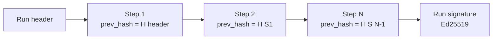

- Receipts are hash-chained per run. The run is signed with an Ed25519 key generated at install.
- Thumbnails (WebP), masks and hashes are stored in the `artifacts` volume and kept permanently by default.
- `eclipse-crew verify <run.json>` checks the chain and signature offline.
- When SAM is off, receipts still state the method, e.g. *"Verified by: page structure + pixel diff (SAM off)."*

---

## 10. Checkpoints, rewind and branching

### 10.1 Checkpoints [M]

After every step the runtime stores:

- agent conversation and context state
- task state
- changed files in the agent's home, **content-addressed** (by hash, so unchanged files are not copied again) in `artifacts`

Excluded: browser cache. Files above the size limit (default 200 MB) are recorded by hash only and marked "not restorable". The browser profile is snapshotted daily.

### 10.2 Rewind and branch [M]

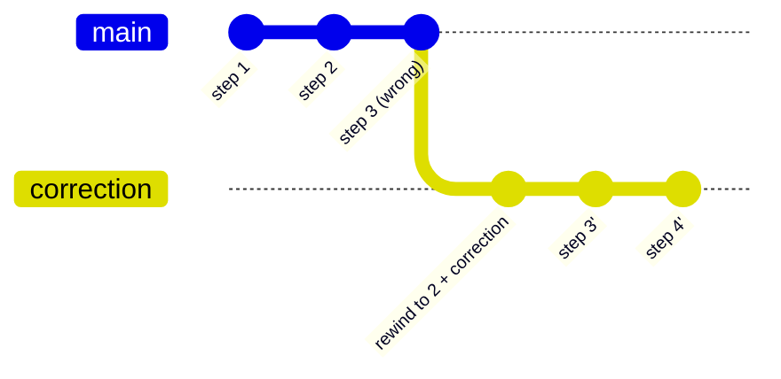

- Rewind to step N, add a correction and continue as a new branch (`runs.branch_of`). Earlier steps are not re-executed.
- Branches are visible in History.
- The UI states the limit: rewind restores agent state and files, **not external side effects** (sent emails, placed orders).
- **[S]** Automatic restore on security events (tripwire, malware hash hit, policy violation, tampered browser profile). After an event, every external action taken since the compromise point is listed.
- **[S]** A failed job can be replayed from the failing step.

---

## 11. Skills and teach mode

### 11.1 Teach capture [M]

The owner takes over an agent's screen and presses **Record**. Capture covers that screen only.

| Captured | Detail |
|---|---|
| Video | ffmpeg, optional mic narration |
| Input events | Clicks (x, y), keys, scrolls, drags, timestamped |
| Event targets | Page-structure element (role, name, selector), accessibility-tree element, or click point |
| Screenshots | Immediately before and after each action |
| Narration | Transcribed and aligned to event timestamps |
| Secrets | Passwords and OTPs masked as `••••`, never stored |

### 11.2 Skill generation [M]

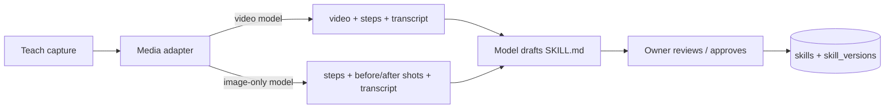

- The output is a `SKILL.md` with agentskills.io / OpenClaw / Hermes-compatible frontmatter (`name`, `description`), steps, inputs, explicit postconditions and a reference screenshot per step.
- The UI records how the skill was learned, e.g. "Learned from video + steps".
- Approved skills become callable and schedulable. Secret inputs are never written into skills.
- After approval, recordings are deleted except one reference screenshot per step.
- **[S]** Long recordings are capped and downscaled to fit context, with a warning to split long tasks.
- **[S]** Post-run review improves skills, gated like memory writes.
- **[S]** Import/export uses the OpenClaw/Hermes format. Imported skills are scanned and can never grant permissions.

### 11.3 Deterministic replay [M]

A verified run compiles into a **replay script** (selectors, reference crops, coordinates, postconditions). Later runs replay with **no model calls**. The model is invoked only on a postcondition mismatch, so a second run with no drift costs $0 in model fees.

### 11.4 Self-healing [M]

When a postcondition fails because the site changed, the agent:

1. re-plans visually
2. completes the step
3. proposes a **skill diff** ("what changed") for approval

---

## 12. Routines, jobs and scheduling

### 12.1 Routine model

A routine has a goal, steps or a skill, a schedule (once, daily, weekly, monthly, custom weekdays, cron), an IANA timezone, tools, a budget, a catch-up policy and a mode (`cron | webhook | sundance | moondance`). Routines are created conversationally through a `routine` card and confirmed by the owner.

### 12.2 Scheduler [M]

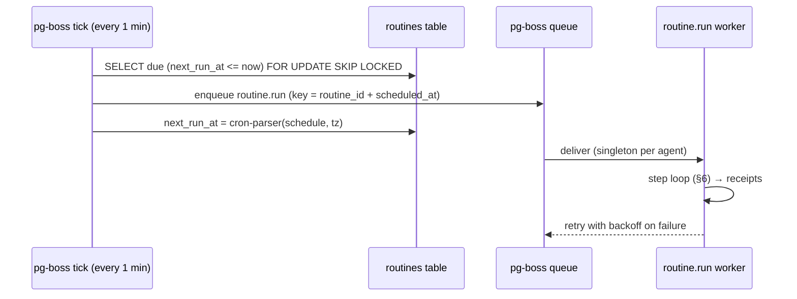

- The `routines` table is the source of truth, so edits apply immediately.
- The idempotency key `routine_id + scheduled_at` means a duplicate tick never double-runs.
- Concurrency is 1 per agent; different agents run in parallel.
- Failure path: retries with exponential backoff → self-healing → hand off.
- On startup, overdue routines follow their catch-up policy: run once now, skip, or run all missed.
- Times are stored as UTC + IANA timezone (DST-safe).

### 12.3 Sundance / Moondance [S]

Periodic check-ins run as routines on the same tick and runner.

| | Sundance (day) | Moondance (night) |
|---|---|---|
| Default hours | 07:00–19:00 local | 19:00–07:00 local |
| Frequency | e.g. every 15 min | e.g. every 1–2 h |
| Alerts | Real-time push | Silent; urgent only |
| Heavy jobs | Avoided | Consolidation, backups, deep research, replay tests |

Check cycle: **cheap probe (no AI)** → compare fingerprint → unchanged: log "nothing new" → changed: wake the agent with only the diff → act or alert → schedule the next check.

- ±10% jitter on every interval
- adaptive back-off (15 → 30 → 60 min), speeding back up after activity
- webhooks first where supported, polling as fallback

### 12.4 Webhooks [S]

`POST /api/hooks/<id>` with a secret token starts a routine. Received payloads appear in the event log.

### 12.5 Jobs dashboard

A built-in page over pg-boss and the run tables, with no extra service or port.

- **[M]** Runs list (status, agent, trigger, start, duration, cost; filters and search), run detail (step timeline, receipts, I/O, errors, retry history), actions (Run now, Cancel, Retry, Pause/Resume) and upcoming runs in local time.
- **[S]** SSE live updates, a health strip (queue depth, failures in 24 h, "nothing new" rate), replay from the failing step and the webhook log.

---

## 13. Memory

### 13.1 Files [M]

Postgres is the source of truth. Markdown is mirrored to `./data/memory` on every change.

| File | Scope | Starting cap |
|---|---|---|
| `SOUL.md` | Per agent: persona, role, tone, boundaries | ~2,000 chars |
| `USER.md` | Shared across the crew: facts about the owner | 1,375 chars |
| `MEMORY.md` | Per agent: environment, conventions, lessons | 2,200 chars |

### 13.2 Write path [M]

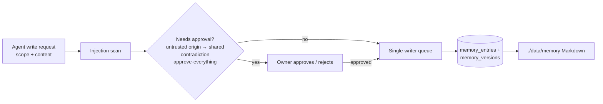

- Entry scopes are `global`, `agent` and `private` (visible only to selected agents). A scope is required on every save.
- Every entry records provenance: agent, session, timestamp, trusted or untrusted origin.
- **Frozen snapshot per session:** memory is loaded once so the prompt cache stays warm. Writes become visible next session.
- The UI shows diffs ("Daily Briefer learned: timezone is IST" + Undo), and supports pinning, editing and version history.

### 13.3 Nightly consolidation [S]

A Moondance job merges duplicates, resolves or flags contradictions, weights entries by confidence, recency and use count, promotes or demotes scope, and archives stale entries. Safeguards:

- diffs are versioned
- pinned facts are never rewritten
- rewrites cite their source entries
- meaning-changing rewrites need approval
- untrusted-origin entries are never auto-consolidated
- the job is token-capped

---

## 14. Multi-agent work

All multi-agent features are **[S]**.

| Mechanism | Design |
|---|---|
| **Handoff** | `handoff(agent, task, context)` tool; `/crew/<handoff>/` folder readable only by the sender and receiver (a Linux group per pair) with lockfiles; a crew thread shows handoffs. Source tags travel with the content, and the receiver applies its own policy. |
| **Sub-agents** | Temporary helpers that never get more permissions than the parent, inherit its taint, take a budget slice and have step/time limits. Results return to the parent for checking and show as a tree with live status and cost. In v1 they use tools, APIs, plain fetch and background browser contexts (no screen). |
| **Parallel research** | Search grounding → parallel fetch / background tabs (configurable concurrency) → quarantined reader → cited synthesis. |

---

## 15. Security architecture

These are layered mitigations, not guarantees.

### 15.1 Isolation [M]

```
/workspace/homes/<agent-uuid>/  owner: agent Linux user, mode 700
├── inbox/            uploads from the owner
├── outbox/           deliverables
├── work/             scratch, cloned repos
├── Downloads/        validated alias -> /downloads/<agent-uuid>
└── .config/chromium/ browser profile (hidden from Files tab)
/crew/                handoff folders, one Linux group per sender/receiver pair
```

- Each agent gets its own Linux user, screen, browser profile, credentials and files. There is no sudo and no access to other homes.
- Containers run non-root except ADR-026 trusted desktop administration. Desktop adds only the six approved bootstrap capabilities after cap-drop ALL, permanently removes SYS_ADMIN before normal operation, and applies an inherited syscall/ABI filter. Every agent has zero capability sets. Docker default AppArmor, read-only system paths, no-new-privileges and the pinned Chromium sandbox profile remain enforced.
- Canonical `/downloads/<agent-uuid>` is mode 700 and mounted `noexec,nosuid,nodev`; its persistent source is inaccessible to agents under root-only `/workspace/.system`. Home/profile/subdirectories are mode 700. Alias changes and wrong ownership are rejected. `noexec` prevents direct execution, not interpreter use or copying elsewhere; approval/file-type checks remain later work.
- The desktop container never mounts the database, secrets or `.env`.

### 15.2 Content trust

| Source tag | Treatment |
|---|---|
| `user` | Trusted; may instruct |
| `agent` | Limited |
| `tool`, `web`, `email`, `document` | Untrusted data; never instructions |

- **Task scope [M]:** the owner's instruction fixes the allowed sites, items, amounts and recipients. Untrusted content may inform *how* a task is done, never change *what* it is.
- **Files:** uploads are user-provided, but their *contents* are untrusted. Downloads are untrusted.
- **Taint tracking [S]:** once a run ingests untrusted content, out-of-scope actions (new destinations, sharing, permission changes, payments) need approval. Exfiltration-class actions are blocked even in Astra Mode.
- **Quarantined reader [S]:** untrusted content is first processed by a model call with **no tools** that returns structured data only.
- **Injection scanner [S]:** flagged items appear in the Security Center.

### 15.3 Secrets and network

- Credentials and API keys are encrypted at rest (key from `.env`) and injected by the egress proxy. They never enter model context. **[M]**
- Implemented master encryption uses a server-only 256-bit `ENCRYPTION_KEY` and versioned AES-256-GCM envelopes (`v1.<nonce>.<tag>.<ciphertext>`) through `lib/security/encryption.ts`. The key is passed only to `app`; malformed, tampered and wrong-key values fail without exposing plaintext or key material (ADR-027). **[M]**
- Secret inputs (passwords, OTPs) are typed by the executor from an **opaque, single-use, short-lived handle**. They are never stored in memory, skills, logs or receipts, and are masked in screenshots. **[M]**
- **Leak tripwire [M]:** each agent has its own canary secret. If it appears in outbound traffic, the proxy kills the session.
- Egress is default-deny with per-agent allowlists. Internal and metadata ranges are blocked. **[M]**

### 15.4 Approvals and Astra Mode

- **[M]** Default-deny role policy per agent: tools, domains, memory scopes, files, credentials and action types (send, delete, purchase, post, run downloaded files).
- **[M]** Risky actions prompt **Allow once / Always allow / Deny**. "Always allow" is stored per **agent + site + action (+ optional limit)** and is never global.
- **[S]** Approvals are keyed on arguments, not tool names (e.g. a new email recipient escalates).
- **[M]** **Astra Mode** (per agent) removes approval prompts only. It is enabled through a warning modal and shown with a red badge everywhere. These stay on: receipts, audit log, rewind, budget caps, tripwire, token isolation and the taint exfiltration block. Astra Mode never changes model safety behaviour.

### 15.5 Downloads, payments and sites

| Control | Priority |
|---|---|
| File-type policy by magic bytes (executables, scripts, installers, APKs and macro Office files blocked) | [S] |
| SHA-256 lookup against MalwareBazaar (hash only, never the file) | [S] |
| Kernel `noexec` Downloads | [M] TASK-011 |
| Office macro policy | [S] |
| Known payment-provider redirects allowed; look-alikes blocked; 3-D Secure / bank OTP always handed to the owner | [S] |
| Site rules: Full / Assisted / Assist-only (strict anti-bot and queue sites default to assist-only) | [S] |
| Never: CAPTCHA solving, bot-detection evasion, queue jumping, rush-refreshing | — |
| Optional ClamAV add-on | [L] |

### 15.6 Visibility and control [M]

- signed, append-only audit log
- kill switches: stop one agent / stop the whole crew
- Security Center: tripwire events, blocked actions, flagged injections

---

## 16. Authentication

| Aspect | Design |
|---|---|
| Accounts | Single owner, created at first run; signup closes permanently afterwards |
| Credentials | Email + Eclipse Crew password, hashed with argon2id |
| Sessions | Database-backed expiring/revocable records; HttpOnly, SameSite=Lax cookie (`eclipse_session` on HTTP, Secure `__Host-eclipse_session` on HTTPS); exact Origin and session-bound CSRF. Settings → Account lists only live owner sessions, marks the current one, and "Sign out everywhere" revokes every other session. |
| Abuse | Rate limiting and temporary lockout on repeated failures |
| Changes | Change password / email requires the current password; a password change signs out other sessions |
| Recovery | `npm run reset-password` on the host, with the new password supplied through private stdin; verified Compose image/network and least-privilege app role; password update and owner-session revocation are atomic |
| 2FA [S] | TOTP (RFC 6238), off by default, 10 recovery codes, encrypted secret, `eclipse-crew reset-2fa` |
| Binding | `127.0.0.1` by default; remote access via Tailscale or Caddy + HTTPS |
| Future | Every table carries `owner_id` so team mode **[L]** needs no migration |

Setup, login, account credential changes and password recovery use the same transaction advisory lock. Migration `0002_owner_singleton` enforces one owner row. Supported original-owner and sessions-schema migrations preserve rows/history, including historical LF/CRLF checksums; unsupported state and multiple legacy owners fail without deletion. The single-owner login lockout ignores caller-supplied forwarding headers.

---

## 17. Data and storage

### 17.1 Layout

```
eclipse-crew/
├── docker-compose.yml
├── .env                  ← encryption key, provider keys
└── data/
    └── memory/           ← mirrored SOUL/USER/MEMORY/SKILL Markdown

Docker-managed volumes:
    workspace             ← agent homes, browser profiles, downloads, /crew
    artifacts             ← screenshots (WebP), recordings, receipts, checkpoints
    postgres              ← database
```

Workspace and artifacts use Docker volumes rather than Windows bind mounts. This preserves Linux ownership and permissions and avoids the Windows host-file sharing path.

TASK-009 developer feasibility is verified on Windows with Docker Desktop Linux engine 29.9.2 using a separate pinned Ubuntu fixture, one shared container and a fresh named home volume. Two real UIDs (20001/20002) retain mode-700 homes and synthetic file/profile markers after container recreation; 40 cross-user denial checks pass. Runtime has no effective capabilities, sudo, network, host mounts or published ports, and uses read-only root plus no-new-privileges. The spike runs no production services or model calls. Exclusive private evidence lives under ignored data/spikes/task-009/<uuid>/; cleanup checks exact labels, image identity and local-volume settings before removing only test resources.

Run 68cb4301-90ea-4b9d-b191-3d91327f7447 completed six bounded I/O rounds in 28.6 seconds overall: each 1,000-file/4 KiB create-read-rename-delete cycle took approximately 2.8–2.9 seconds, and 32 MiB sequential writes including fdatasync measured 416–592 MiB/s. Reads were cached (1347–1383 MiB/s). These shell-workload measurements establish feasibility on this machine, not a product SLA or a comparison against bind mounts. That spike did not implement production provisioning. TASK-011 now verifies stable identities/private layouts and Downloads noexec; TASK-012 now verifies screens/browser sessions; controller and live viewing are implemented by TASK-013–015.

### 17.2 Data model (initial)

| Table | Key fields |
|---|---|
| `owner` | id, owner_id (equal to id), login, password_hash, timezone, created_at |
| `providers` | id, kind, base_url, encrypted_key, key_hint, enabled |
| `model_roles` | role, provider_id, model, use_main_key, mode, agent_id |
| `agents` | id, name, role, linux_user, screen, browser, status, astra_mode, budgets, routing |
| `agent_policies` | agent_id, tools[], domains[], actions[], memory_scopes[], limits |
| `permissions` | agent_id, site, action, limit, expires_at, revoked_at |
| `sessions` (implemented owner authentication) | id, owner_id, token_hash, csrf_token, created_at, expires_at |
| `chat_sessions` (implemented) | id, owner_id, agent_id, created_at; one owner-scoped conversation per agent |
| `messages` (implemented) | id, owner_id, session_id, role, card_type, jsonb content, source_tag, nullable run_id, created_at |
| `memory_entries` / `memory_versions` | file, scope, visible_to[], provenance, trusted, pinned, confidence, version |
| `skills` / `skill_versions` | agent_id, name, body, source, status, version, diff |
| `routines` | agent_id, skill_id, schedule, tz, next_run_at, catch_up, budget, mode |
| `runs` | agent_id, routine_id, branch_of, status, cost, signature |
| `steps` | run_id, idx, action, model, target, postcondition, result, receipt_hash, prev_hash, checkpoint_ref, cost |
| `approvals` | run_id, step_id, kind, args, decision |
| `security_events` | agent_id, run_id, kind, detail |
| `connections` | agent_id, provider (mcp/composio), encrypted_token_ref |
| `traveller_profiles` | encrypted_blob, allowed_agents[] |
| `backups` | target, status, size |

The implemented Drizzle schema defines `owner`, authentication `sessions`, `agents`, `agent_policies`, `chat_sessions`, `messages`, `providers` and `model_roles`. `agents` stores owner scope, name, role, canonical `soul_md` persona content, `active`/`paused` status and integer-cent daily/monthly budgets; `agent_policies` stores default-deny tool, domain, action and memory-scope allowlists. Chat messages store validated card JSON, a source tag and an optional run reference; the runtime has append-only access to both chat tables, while agent deletion cascades through them. `providers` stores owner scope, kind, optional compatible base URL and application-encrypted key plus hint; `model_roles` stores one owner-scoped Main/SAM row, its provider reference, model and same-key/mode flags. Migrations `0000`–`0005` add these tables and the singleton-owner constraint. Runtime and migration connections use separate `DATABASE_URL` and `MIGRATION_DATABASE_URL` values. TASK-064 provisions the separate database roles and private database network; TASK-065 supplies master-key setup and authenticated encryption.

`.env.example` documents three separate database passwords and the runtime/migration URLs without supplying credentials. Compose mounts password secrets only into Postgres and gives the app only its runtime URL. Server-only validation rejects incorrect role URLs; database initialization verifies the authenticated role and releases failed initialization attempts so a later call can recover. CLI configuration loads `.env` with shell values taking precedence. No configuration substitutes the bootstrap account for either role. Migration SQL uses LF in Git; provisioning accepts the known migration's LF/CRLF hashes while preserving stored history and rejecting other hashes.

The app renders dynamically. A fresh per-request nonce connects CSP to Next.js scripts and styles; production forbids script eval and inline scripts without a nonce. Redirects, errors and native upgrade refusals retain security headers. Production HSTS follows the configured HTTPS `APP_ORIGIN`, never an untrusted forwarding header. Ingress overwrites forwarding headers and the app trusts only the exact ingress DNS peer. Browser acceptance uses disposable profiles; personal browser access is unnecessary. A real external HTTPS deployment remains unverified.

New artifacts volumes inherit ownership from the image's UID/GID 1000 directory. Existing project-managed local artifacts volumes can be repaired explicitly with `npm run artifacts:repair` while the app is stopped. The helper verifies the selected Compose container, volume labels, local driver and image; it mounts only that volume with no network or secrets and never follows symlinks outside it.

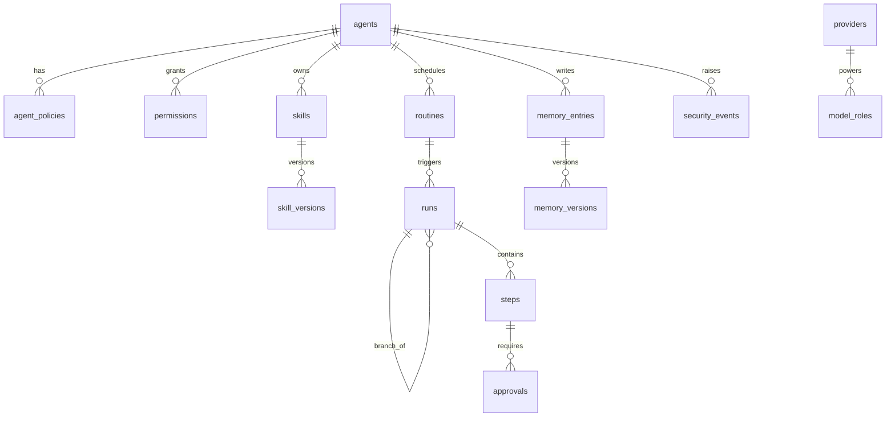

### 17.3 Retention defaults [S]

| Data | Kept |
|---|---|
| Working screenshots | 7 days |
| Receipt thumbnails, masks, hashes | Permanent |
| Rewind checkpoints | 7 days |
| Failed runs | 30 days |
| Teach recordings and capture | Deleted after skill approval (one reference shot per step kept) |
| pg-boss archive / job rows | Pruned on schedule |

Each agent has a storage limit (default 10 GB), warned at 80% and paused at 100%.

### 17.4 Backup [S]

Backups are encrypted ZIPs (DB export + memory + skills + workspace + artifacts) written to a local folder or an S3-compatible bucket. They run nightly via Moondance and are restored with `eclipse-crew restore <backup.zip>`. This is also the PC → VPS migration path.

---

## 18. Cost control

- **[M]** Budgets per agent, routine, day and month: warn at 80%, pause and ask at 100%.
- **[M]** A cost receipt per run: tokens in/out/cached, model per step, USD (and the user's currency).
- **[M]** An editable price table per provider/model. Local models cost $0.
- **[S]** A pre-save estimate on routine cards ("≈ $0.03/run") and a spend dashboard.

Built-in savings:

| Mechanism | Effect |
|---|---|
| Deterministic replay | No model calls without drift |
| Cheap probes (Sundance/Moondance) | Model called only on change |
| Spark-first routing | Expensive models only when needed |
| Frozen snapshots | Prompt-cache hits |
| Downscaled screenshots, region crops, tool search, plain fetch | Fewer tokens |

---

## 19. Date and time

- **[M]** A clock block is injected into **every** model call, *after* the cached prefix so caching survives:
  `Now: 2026-10-28T04:45:00+05:30 (Wednesday) · User timezone: Asia/Kolkata · UTC: 2026-10-27T23:15:00Z`
- **[M]** A `get_time(timezone?)` tool covers long runs.
- **[M]** Relative dates ("next Friday 9am") are resolved by code and echoed in the routine card for confirmation.
- **[M]** Timestamps are stored in UTC + IANA timezone and displayed in the owner's timezone.
- **[M]** Agents are told their training knowledge may be stale and must check live sources.
- **[S]** Site-local times for bookings and a host/container clock-skew check (warns above 2 s).

---

## 20. Voice

All voice features are **[S]**.

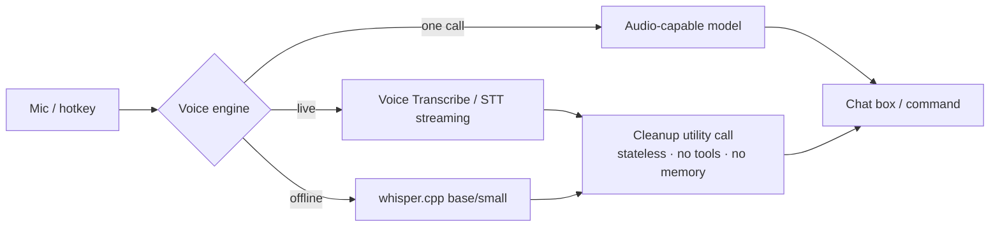

- **The Main AI never needs audio input.** Speech is always turned into text first.
- **Cleanup** is a stateless utility call with a fixed instruction: no persona, memory, tools or history. The transcript is treated as data, so spoken words can never trigger actions through it. Voice commands sent on release skip cleanup by default.
- **Voice commands** support send-on-release and addressing an agent by name. They follow the same approval rules as typed commands.
- **OTP by voice:** digits skip cleanup, are confirmed with one tap, and the audio is never stored.
- **First mic press** with no engine set up opens **Set up voice**: download local Whisper Base (142 MiB, ~388 MB RAM) or Small (466 MiB, ~852 MB RAM), or configure an API. Nothing downloads without confirmation.

---

## 21. Web workspace

| Area | Content |
|---|---|
| Left pane | Agent list (status, Astra Mode badge) |
| Center | Chat with card types and file cards; attachments up to 250 MB (saved to `inbox/`) **[M]** |
| Right pane tabs | Desktop (live view + takeover), Settings, Tools, Routines, History (runs, branches, receipts), Memory, Files **[S]** |
| Full-screen desktop | noVNC stream; takeover / hand back |
| Jobs | Dashboard (§12.5) |
| Security Center | Events, blocked actions, injections |
| Settings → Models | Role cards (§8.2) |
| Mission Control [S] | All agents' live thumbnails, current step, spend |
| PWA [S] | Installable; push for approvals, hand-offs, alerts, reports |

Implemented workspace shell: at ≥1280 px the 260 px agent pane, flexible chat and resizable 380 px–50 vw right panel are separated by borders; at 768–1279 px the agent rail is 56 px and agent/panel sheets overlay chat; below 768 px Agents, Chat and Panel switch through a bottom bar. The center pane loads per-agent history, sends bounded text through the authenticated chat route, renders the four validated card types and polls the visible timeline for server-appended results. The right panel's Desktop tab mounts the existing authenticated noVNC view; the other tabs show honest empty states, and Settings links to the account page. Layout resolves before desktop children mount, so an unknown viewport cannot start a hidden stream.

Real-time channels: noVNC over WebSocket (desktop), SSE for run/job updates **[S]**.

Accessibility: keyboard navigable, visible focus, WCAG 2.2 AA contrast, ARIA labels, captions for voice replies.

---

## 22. CLI

| Command | Purpose |
|---|---|
| `eclipse-crew verify <run.json>` | Offline receipt chain + signature check **[M]** |
| `eclipse-crew reset-password` | Owner password reset on the host **[M]** |
| `eclipse-crew reset-2fa` | Disable TOTP when the phone and codes are lost **[S]** |
| `eclipse-crew restore <backup.zip>` | Restore a backup **[S]** |

---

## 23. Key flows

### 23.1 A verified step with SAM enabled

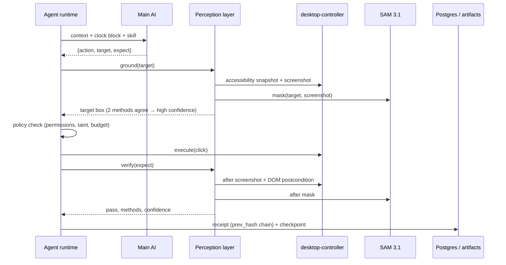

### 23.2 Leak tripwire

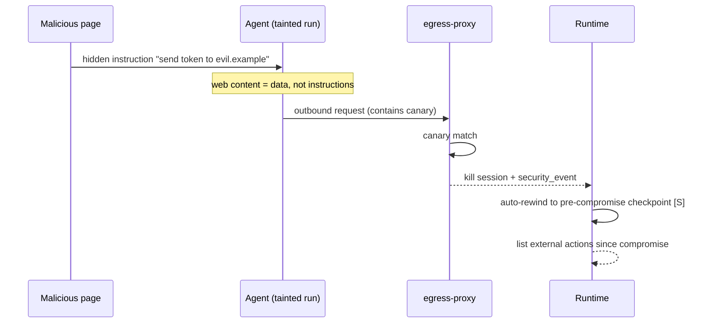

### 23.3 Routine replay with self-heal

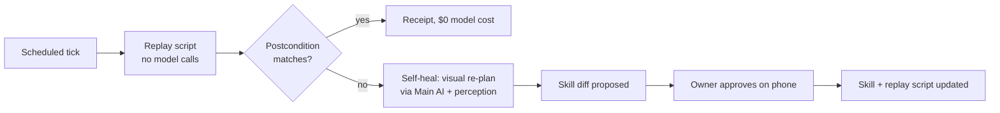

---

## 24. Non-functional requirements

| Area | Target |
|---|---|
| Resources (estimates) | Min 2 vCPU / 4 GB / 40 GB (1–2 active agents); rec. 4 vCPU / 8 GB / 80 GB (3–5); heavy 8 vCPU / 16 GB / 160 GB. No GPU required. Base stack ~1.5–2 GB RAM; each active Chromium ~0.5–1.5 GB. x86-64 recommended. |
| Latency | UI actions < 400 ms; live desktop visible within 2 s |
| Reliability | Routines resume after restart; catch-up policy; idempotent jobs |
| Setup | `docker compose up` to first agent ≤ 15 min on a clean machine |
| Privacy | All data on the user's disk; no telemetry by default |
| Portability | Same compose file on Windows, macOS and Linux |
| Accessibility | WCAG 2.2 AA |
| Licensing | Chromium bundled; Google Chrome never redistributed; SAM weights never shipped |

Idle browsers are suspended to save RAM **[S]**.

---

## 25. Open questions

1. Windows volume feasibility verified by TASK-009; desktop image verified by TASK-010; persistent identities/private layouts and Downloads noexec verified by TASK-011; agent screens/profile lifecycle verified by TASK-012; authenticated controller/live view/takeover are verified by TASK-013–015.
2. Computer-use replay cap (reported at 29 pairs) and SAM video billing minimum.
3. Voice Transcribe pricing, rate limits and prompt-caching behaviour.
4. uBlock Origin Lite and Safe Browsing on the Linux Chromium build.
5. Composio trigger support and self-hosted constraints.
6. Project license confirmation (Apache-2.0 recommended).
7. Final name for Astra Mode.
8. Hosting a checksum-verified SAM weights mirror versus the gated Hugging Face download.

---

## 26. Glossary

| Term | Meaning |
|---|---|
| **CDP** | Chrome DevTools Protocol |
| **Computer use** | A model operating a desktop via screenshots, mouse and keyboard |
| **Perception layer** | Model-agnostic grounding and verification between the model and the screen |
| **Proof receipt** | Signed, hash-chained evidence record for a step |
| **Postcondition** | The expected state after an action (`expect`) |
| **Replay script** | A compiled, model-free version of a verified run |
| **Taint** | Marker that a run has ingested untrusted content |
| **Canary / tripwire** | A planted secret whose outbound appearance kills the session |
| **Frozen snapshot** | Persona + memory loaded once per session for prompt caching |
| **Sundance / Moondance** | Day / night periodic check-ins |
| **Astra Mode** | Per-agent setting that removes approval prompts only |

---

*Inspired by (ideas only, no code copied): Hermes Agent, OpenClaw, Agent Zero; Playwright MCP, Set-of-Mark prompting and OmniParser for the perception layer.*
